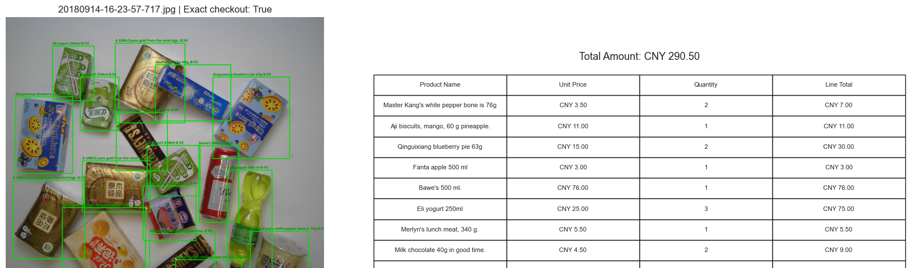

# Smart Checkout: Retail Product Detection and Automatic Checkout

A computer vision project that detects and recognizes multiple retail products in a checkout image, counts each SKU, estimates the total price using simulated product data, and generates an English checkout receipt.

This project was developed for **AI-LAB – Computer Vision, Signal Processing, and Natural Language Processing** at Sapienza University of Rome.

## Overview

Automatic checkout is challenging because products may look very similar, overlap, or appear in different orientations and scales. Detecting an object is not enough: the system must also count every SKU correctly to produce an accurate shopping list.

This project builds an end-to-end pipeline using the **Retail Product Checkout (RPC) dataset** and **Ultralytics YOLO11**. It compares a lightweight model, YOLO11n, with YOLO11s, the main model.

## Pipeline

1. **Dataset preparation** — Convert RPC annotations from COCO JSON to normalized YOLO format.
2. **Grouped data splitting** — Keep images from the same capture group in the same subset to reduce leakage between training, validation, and test data.
3. **Product detection** — Fine-tune pretrained YOLO11n and YOLO11s models to detect and classify 200 SKU classes.
4. **SKU counting** — Group detections by SKU and count repeated products.
5. **Price lookup** — Retrieve each product's name and simulated unit price from a predefined metadata table.
6. **Checkout calculation** — Calculate line totals and the final amount.
7. **Receipt generation** — Generate an English receipt containing product names, unit prices, quantities, line totals, and the total cost.

> **Note:** Prices are simulated and denominated in CNY. They are not retrieved from a live retailer database.

## Example Results

### Product detection and generated checkout receipt

The pipeline aggregates detections by SKU, looks up simulated prices, and generates a checkout table with quantities, line totals, and the final amount. The presentation includes examples where the predicted SKU counts exactly match the ground truth.

## Dataset

The experiment uses the multi-product checkout scenes from the RPC dataset. The original validation and test checkout scenes are combined and reorganized into a custom split.

| Subset / property | Value |
|---|---:|
| Checkout images | 30,000 |
| Product instances | 367,935 |
| SKU classes | 200 |
| Average products per image | 12.25 |
| Training images | 23,985 |
| Validation images | 2,970 |
| Test images | 3,045 |
| Training instances | 294,410 |
| Validation instances | 36,568 |
| Test instances | 36,957 |

The split is approximately 80% training, 10% validation, and 10% test. A capture-group identifier derived from RPC filenames is used to keep images in the same group together.

**Important:** This is a custom experimental split, not the official RPC benchmark protocol. Results should not be interpreted as official RPC leaderboard scores.

## Models and Training

Two pretrained Ultralytics YOLO11 models are fine-tuned on the converted dataset.

| Setting | Value |
|---|---|
| Framework | Python, PyTorch, Ultralytics YOLO |
| Baseline model | YOLO11n |
| Main model | YOLO11s |
| Optimizer | AdamW |
| Initial learning rate | 0.001 |
| Batch size | 64 |
| Image size | 640 × 640 |
| Training epochs | 10 |
| Random seed | 42 |
| Evaluation environment | NVIDIA GeForce RTX 4090, CUDA 12.8 |
| Ultralytics version | 8.4.126 |

Both models use the same data split and training configuration to make the comparison more meaningful.

## Evaluation

In addition to conventional object-detection metrics, the project introduces **strict checkout accuracy (`cAcc`)**.

A checkout is counted as correct only if the predicted quantity of **every SKU** exactly matches the ground truth for that image. A single missed or duplicated product can make the entire shopping list incorrect.

### Test results

| Metric | YOLO11n | YOLO11s |
|---|---:|---:|
| Precision | 99.51% | 99.54% |
| Recall | 99.39% | 99.56% |
| mAP@0.5 | 99.46% | 99.48% |
| mAP@0.5:0.95 | 87.74% | 88.69% |
| Strict checkout accuracy | 92.94% | **94.91%** |
| Inference latency | **0.7260 ms** | 1.4308 ms |

The confidence threshold is selected on the validation set by maximizing strict checkout accuracy, using mean count error as a secondary criterion. The selected threshold is then applied to the test set.

### Key findings

- **YOLO11s is more accurate:** It reaches 94.91% strict checkout accuracy, compared with 92.94% for YOLO11n.
- **YOLO11n is faster:** Its measured inference latency is approximately half that of YOLO11s.
- **High mAP does not guarantee a correct receipt:** Even a small detection or counting error can make the complete SKU inventory incorrect. Application-level evaluation is therefore important.

## Limitations and Future Work

### Limitations

- Training is limited to 10 epochs, so the models may not be fully optimized.
- The custom data split differs from the official RPC benchmark.
- Product names and prices come from a predefined simulated metadata table.
- Heavy occlusion and visually similar adjacent SKUs can still cause counting errors.
- The system is a prototype, not a production-ready commercial checkout solution.

### Possible improvements

- Train for more epochs and evaluate additional confidence and IoU settings.
- Analyze performance by checkout-scene clutter level.
- Compare YOLO11 with other detector families.
- Integrate a real product database with validated product names, barcodes, prices, and availability.

## Conclusion

This project demonstrates how a standard object detector can be integrated into a complete checkout workflow, from product recognition to receipt generation. YOLO11s provides the best exact shopping-list accuracy in the experiment, while YOLO11n offers a faster alternative for latency-sensitive deployments.

The main contribution is the reproducible end-to-end pipeline and the use of strict SKU-count accuracy alongside conventional object-detection metrics.

## References

- Wei et al., [RPC: A Large-Scale and Fine-Grained Retail Product Checkout Dataset](https://arxiv.org/abs/1901.07249).
- [RPC Dataset Project](https://rpc-dataset.github.io/).
- Redmon et al., [You Only Look Once: Unified, Real-Time Object Detection](https://doi.org/10.1109/CVPR.2016.91).
- Ren et al., [Faster R-CNN: Towards Real-Time Object Detection with Region Proposal Networks](https://arxiv.org/abs/1506.01497).
- Liu et al., [SSD: Single Shot MultiBox Detector](https://doi.org/10.1007/978-3-319-46448-0_2).
- Lowe, [Distinctive Image Features from Scale-Invariant Keypoints](https://doi.org/10.1023/B:VISI.0000029664.99615.94).
- [Ultralytics YOLO11 Documentation](https://docs.ultralytics.com/models/yolo11/).
